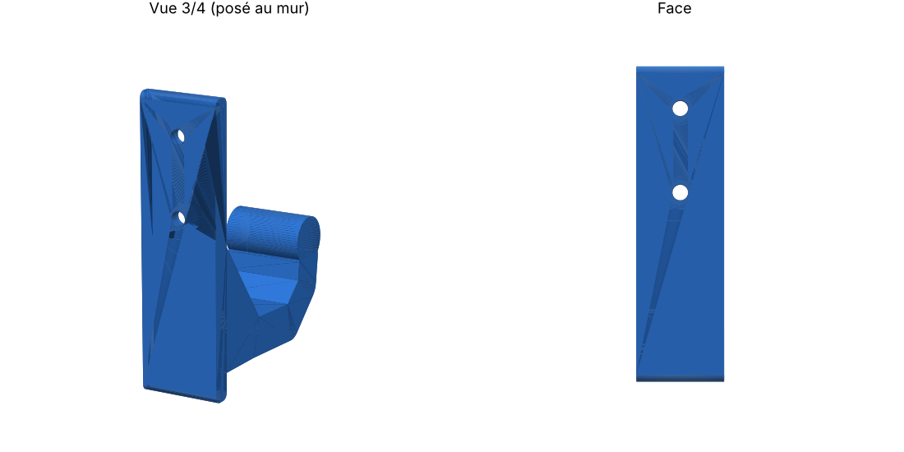

# Porte-manteau mural

| Fichier | Rôle |
|---|---|
| `porte-manteau.stl` | prêt à ouvrir dans le trancheur |
| `porte-manteau.scad` | modèle paramétrique OpenSCAD (modifie les cotes en haut du fichier) |
| `generer_stl.py` | régénère le STL sans OpenSCAD (`pip install manifold3d trimesh`) |

## Dimensions
- Plaque murale : 90 × 25 × 6 mm, avec deux trous fraisés pour des vis de 4 mm
- Avancée du crochet : environ 63 mm, avec une boule au bout pour retenir les vêtements
- Environ 42 cm³ de matière pleine, soit à peu près 25 à 35 g de PLA selon le remplissage

## Impression
- **Ne pas faire pivoter la pièce** : elle est déjà posée sur le flanc. Les couches suivent la courbe du crochet, ce qui le rend nettement plus solide. Aucun support n'est nécessaire.
- Matériau : PETG de préférence (il est plus résistant au fluage sous charge), sinon du PLA.
- 4 périmètres, 30 à 40 % de remplissage en gyroïde, couches de 0,2 mm
- Visser avec des chevilles adaptées au mur.
