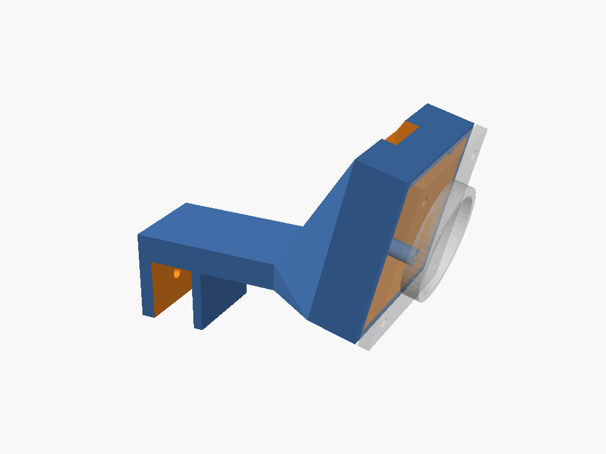

# Support caméra OV9732 pour anneau lumineux Target

Support à imprimer en 3D (style bras + tête inclinée + capot avant) pour fixer
une caméra OV9732 (carte 32 × 32 mm, trous à 28 × 28 mm, type Autodarts) sur
un anneau lumineux Target (Corona Vision, etc.).

## Fichiers

| Fichier | Quantité | Rôle |
|---|---|---|
| `test_clip.stl` | 1 | Juste le clip, à imprimer **en premier** pour vérifier qu'il tient sur l'anneau |
| `support.stl` | 3 | Clip + bras + tête qui reçoit la carte caméra |
| `capot.stl` | 3 | Capot avant avec collerette autour de l'objectif |
| `support_camera_ov9732.scad` | – | Modèle paramétrable (OpenSCAD) pour ajuster les cotes |

## À mesurer avant d'imprimer

Les STL sont générés avec des valeurs par défaut. **Mesurez au pied à coulisse**
et modifiez le `.scad` si besoin (OpenSCAD → Fenêtre → Customizer) :

- `anneau_epaisseur` (10 mm par défaut) : épaisseur du bord de l'anneau sur lequel le clip s'emboîte
- `carte_cote` / `carte_entraxe` : 32 / 28 mm (mettre 38 / 34 pour les grandes cartes)
- `objectif_ouverture` : 15 mm, pour un porte-objectif M12 carré de 14 mm
- `angle_camera` : 15°, l'inclinaison vers la cible
- `bras_longueur` : 30 mm, la distance entre l'anneau et la tête

Pour exporter : `piece = "support"`, `"capot"` ou `"test_clip"`, puis F6 et Export STL.

## Impression

- PETG de préférence (PLA possible si l'anneau ne chauffe pas), 0,2 mm, 4 périmètres, 30 % de remplissage
- Le support s'imprime **couché sur le flanc** (orientation déjà prévue dans le STL) : pas de support d'impression, et le bras est solide dans le bon sens
- Le capot s'imprime à plat, collerette vers le haut

## Montage

1. Glisser la carte dans la tête, le connecteur vers l'arrière et le câble par l'encoche du haut.
2. Poser le capot (objectif dans l'ouverture) et visser 4 vis **M2 × 12** auto-taraudeuses : elles traversent capot et carte et se vissent dans les piliers.
3. Emboîter le clip sur le bord de l'anneau, tête vers le centre de la cible.
4. Optionnel : une vis **M3 × 8** dans le trou latéral du clip pour le bloquer.
5. Répartir les 3 caméras à environ 120° autour de la cible.
